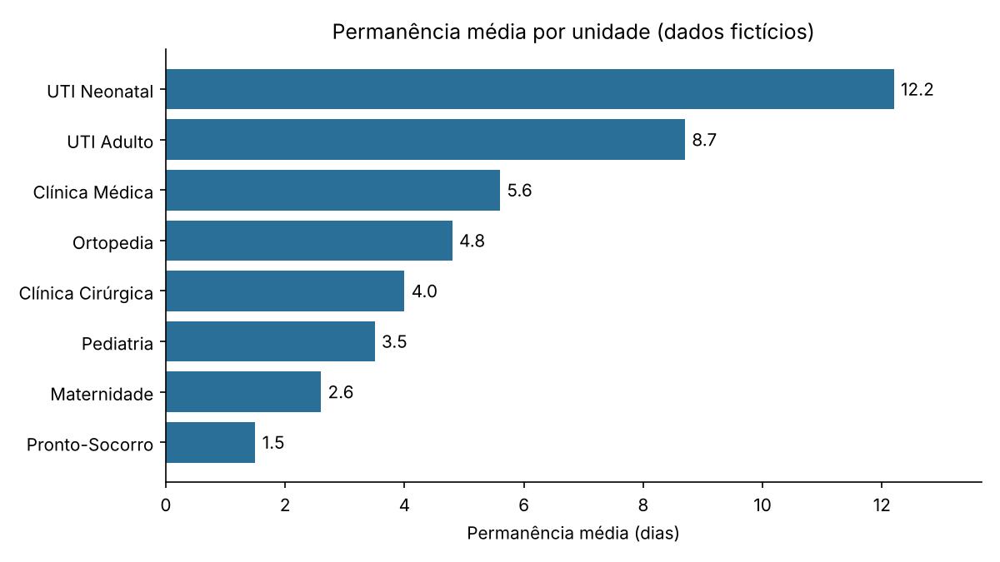

# Projeto 1 — Limpeza de dados e relatório automatizado

Script em Python (pandas) que recebe uma base hospitalar **suja**, corrige o que dá para
corrigir, e gera automaticamente uma base limpa, um relatório e um gráfico.

> Os dados são fictícios e foram gerados por `../scripts/gerar_dados.py`.

## O problema

Dados reais raramente chegam prontos. A base `dados/internacoes_brutas.csv` simula isso:
5.100 linhas de internações com datas em três formatos, nomes de unidade digitados de várias
formas, valores ausentes, valores impossíveis e linhas duplicadas. Qualquer indicador
calculado em cima dela sairia errado.

## O que o script faz

| Problema encontrado | Linhas afetadas | Tratamento |
|---|---|---|
| Linhas duplicadas | 100 | Removidas |
| Nome da unidade digitado de formas diferentes (`UTI ADULTO`, ` uti adulto `...) | 1.775 | Padronizado pelo cadastro de unidades, com recuperação do `id_unidade` |
| Datas em formatos misturados (`2025-03-04 10:00`, `04/03/2025 10:00`, `04/03/2025`) | todas | Convertidas para um formato único |
| Datas sem horário | 2.474 | Assumido 12:00 |
| Saída antes da entrada | 12 | Permanência anulada e linha sinalizada em `data_inconsistente` |
| Tempo de espera negativo | 28 | Convertido em ausente |
| Idade impossível (fora de 0–110) | 15 | Convertida em ausente |
| Sexo escrito por extenso | 1.690 | Padronizado em `F`/`M` |
| Convênio ausente ou `N/I` | 161 | Padronizado como `Não informado` |

### Decisões de limpeza

- **Não imputei valores ausentes** (espera e idade). Preencher com média ou mediana esconderia
  a falta de informação e poderia distorcer os indicadores. As médias simplesmente ignoram
  os valores ausentes, e o relatório informa quantos são.
- **Valores impossíveis viram ausentes**, não são "corrigidos no chute".
- **Linhas inconsistentes são sinalizadas**, não apagadas, para que quem usar a base decida o
  que fazer com elas.
- **Data sem horário recebe 12:00**, uma premissa simples e declarada. Por isso a permanência
  média tem diferenças de poucas centésimas de dia em relação ao valor real.

## Como executar

```bash
pip install -r requirements.txt
python limpar_dados.py
```

O script lê `../dados/internacoes_brutas.csv` e `../dados/unidades.csv`, e cria a pasta `saida/`:

| Arquivo | Conteúdo |
|---|---|
| `saida/internacoes_limpa.csv` | Base tratada, pronta para o SQL e o Power BI |
| `saida/relatorio.md` | O que foi encontrado, o que foi feito e os indicadores por unidade |
| `saida/permanencia_por_unidade.png` | Gráfico de permanência média por unidade |

## Resultados



Depois da limpeza (5.000 internações, de 01/01/2025 a 30/06/2026):

- A **UTI Neonatal** tem a maior permanência média: **12,2 dias**. A **UTI Adulto** vem em seguida, com 8,7.
- O **Pronto-Socorro** tem a menor permanência (**1,5 dia**), mas a maior espera para atendimento: **119 min** em média.
- As **UTIs concentram as maiores taxas de infecção hospitalar**: 9,9% na Neonatal e 8,9% na Adulto, contra 1,4% no Pronto-Socorro.

O relatório completo, com a tabela de todas as unidades, está em [`saida/relatorio.md`](saida/relatorio.md).

## Validação

Como os dados são fictícios, existe uma versão "verdadeira" da base (`dados/internacoes.csv`).
Comparei a base limpa com ela: os identificadores, unidades, leitos, infecções, desfechos e o
**dia** de todas as datas batem em 100% das linhas. Os valores que sobraram (espera, idade,
sexo) também batem onde não foram anulados. A permanência média por unidade difere em no
máximo 0,04 dia, efeito da premissa das 12:00.

## Habilidades demonstradas

Leitura e tratamento de dados com pandas, padronização de texto e datas, regras de qualidade
de dados, tratamento de ausentes e outliers, geração automática de relatório em Markdown e de
gráfico com matplotlib, e validação do resultado.

## Próximo passo

O [Projeto 2](../02-sql-analise/) usa estes dados para responder perguntas de negócio com SQL.
